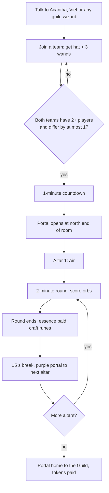

# 01 · What the Great Orb Project is

## One-paragraph version

Two teams of wizards' assistants, **green** and **yellow**, are sent through a portal into a
series of Runecrafting altars. In each altar, glowing orbs of each team's colour appear around the
arena. You carry two wands: one **pulls** (attracts) orbs towards you, and one **pushes** (repels)
them away. You also carry a gadget that puts up a short **barrier**. Your team scores a point each
time one of its orbs reaches the altar. Each altar lasts 2 minutes, and whichever team has scored
more orbs when time runs out wins that altar. A game is 6 altars (free players) or 8 altars
(members). You are paid in **Runecrafting Guild tokens** for every altar you win, draw or lose,
plus a bonus if your team wins most altars, and you get free essence to craft at each altar for
double experience.

## Key facts

| Fact | Value | Source |
|---|---|---|
| Released | 12 August 2008 | Jagex news "Runecrafting Guild and Game - For All Players!"; RS Wiki infobox |
| Where | Runecrafting Guild, reached by a portal at the top of the Wizards' Tower, south of Draynor Village | RS Wiki |
| Requirement | Level 50 Runecrafting (boosts allowed); Rune Mysteries quest | RS Wiki; Jagex news; RuneHQ; 2011.rs KB |
| Players | 4 to 10 (2 to 5 per team) | RS Wiki infobox and rules |
| Teams | Green (Wizard Acantha) and yellow (Wizard Vief) | RS Wiki |
| Altars per game | 6 free (Air, Mind, Water, Earth, Fire, Body); 8 members (+ Chaos, Nature) | RS Wiki, all guides |
| Round length | 2 minutes = 200 ticks per altar, then a 15 s break | RS Wiki |
| Game length | 13 min 30 s free; 18 min members | RS Wiki |
| Currency | Runecrafting Guild tokens | RS Wiki |
| Danger | Safe: you lose nothing if you die | RS Wiki |
| Members only? | No (some rewards and altars are) | RS Wiki |
| Ironmen | Allowed since 5 January 2015, cosmetic rewards and one Blood altar teleport only | RS Wiki |
| Developers | Mod John A and Mod Nancy (RS Wiki); "John A, Nancy J" (fandom wiki, 2011.rs KB) | RS Wiki, 2011.rs |

## The story

The Runecrafting Guild's wizards are researching the energy orbs that gather around rune altars.
Two research groups disagree about them. **Wizard Acantha** (green) believes green orbs are pure
magical energy and yellow orbs are a useless by-product that pollutes the altars. **Wizard Vief**
(yellow) believes exactly the opposite. Each recruits players to push "their" orbs into the altars
and keep the other colour out. That is the whole reason for the game (2011.rs KB copy of the official
Knowledge Base; RS Wiki pages for Acantha, Vief and the orbs). Vief justifies his view with
"Lefebvre equations", a play on the Legendre transform (RS Wiki, *Wizard Vief* trivia).

## How one game flows

## Where to go next

* [02 · Getting there and joining](02-joining-and-teams.md)
* [03 · Equipment: hat, wands and barriers](03-equipment.md)
* [04 · Round flow and timers](04-round-flow-and-timers.md)
* [05 · The tick engine](05-tick-engine.md)
* [06 · Angles and geometry](06-angles-and-geometry.md)
* [07 · The altars and their maps](07-altars-and-maps.md)
* [08 · Scoring and rewards](08-scoring-and-rewards.md)
* [09 · Strategy](09-strategy.md)
* [10 · History and trivia](10-history-and-trivia.md)
* [11 · Contradictions and open questions](11-open-questions.md)
