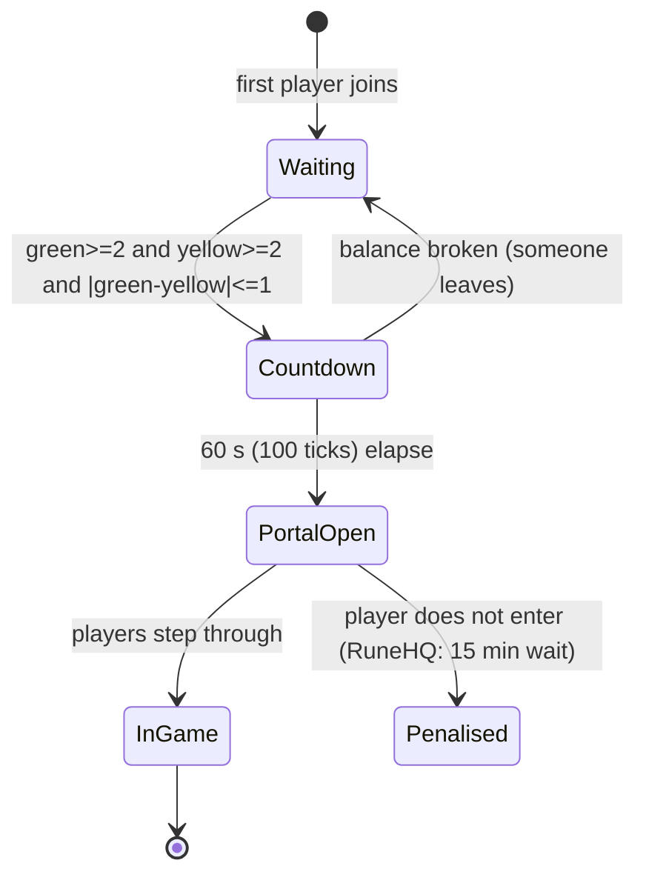

# 02 · Getting there, joining and team rules

## The Runecrafting Guild

* **Where:** the Guild is reached through a blue portal at the top of the **Wizards' Tower**, which
  stands on an island south of Draynor Village, in the kingdom of Misthalin. Since the 2012 graphics
  update the Guild itself is described as lying in the Runespan realm (RS Wiki, *Runecrafting
  Guild*). Older guides disagree on the floor number (Tip.It says "second floor", the 2011.rs KB and
  Jagex say "first floor"). This is only the British and American floor-numbering difference: the
  RS Wiki now just says "top floor".
* **Requirement to enter:** 50 Runecrafting (boostable) (RS Wiki). The Rune Mysteries quest is
  also required by Jagex's 2008 announcement, RuneHQ and the KB. Tip.It does not mention it.
* **Inside:** Wizard Elriss's reward shop, Wizard Korvak (abyssal pouch repairs, omni-talisman
  staff/tiara), a large altar map in the centre, a bank deposit box (added 22 February 2010), the
  "Rune Goldberg Machine", and the two team leaders.

### Ways to get there (RS Wiki unless marked)

| Route | Notes |
|---|---|
| Runecrafting Guild teleport tablet | Bought from Elriss for 15 tokens |
| Free teleport from an altar wizard | Wizards at each rune altar offer teleports to the Wizards' Tower |
| Wicked hood teleport | Lands you on the top floor beside the portal |
| Draynor lodestone, run south | Free |
| Amulet of glory (Draynor Market), traveller's necklace, skills necklace | Members |
| Explorer's ring 3+ "cabbage-port" | Lands at the Draynor/Port Sarim cabbage patch (Tip.It, 2011.rs) |
| Fairy ring code **DIS** | Members |
| Wizards' Guild east portal | Needs 66 Magic |
| Stardust teleport | To Wizard Rosalina, then climb |

## Joining a team

1. Speak to **Wizard Acantha** to join **green**, **Wizard Vief** to join **yellow**, or any other
   Guild **Wizard** to be put on a team for you. The RS Wiki calls this a random team. The
   fuller Wiki text and RuneHQ suggest it fills whichever team is smaller, but that is inferred
   from "can't join a team already larger" and not stated outright.
2. You need **at least 2 free inventory spaces**, an **empty weapon slot**, an **empty helmet
   slot**, and **no head cosmetic override** (a warning for overrides was added 22 July 2013).
3. You are given the **Runecrafter hat** in your team colour and three items: **attractor**,
   **repeller** and **barrier generator**. The hat and the attractor are equipped automatically.

> Inventory check, inferred: 3 items are handed out, but only 2 free slots are required. That fits
> the attractor going straight to the weapon slot and the hat to the head slot, leaving the
> repeller and barrier generator in the pack.

## Team balance rules

* Each team holds **2 to 5 players**.
* The start timer runs **only if both teams have at least 2 players and the sizes differ by at
  most 1** (RS Wiki). The older fandom copy says the timer "resets if one team leads by two".
* You **cannot join a team that already has more players** than the other.
* Once the timer starts it lasts **1 minute**. Then a portal opens at the **north end** of the room.
* The 2011.rs KB says "The portal will only remain open for twenty seconds". This is single-source.
* Leaving **before** the portal opens is free. Destroy any wand or talk to any Guild wizard.

## What happens if you leave mid-game

Ways to "abandon" a game: destroying a wand, letting your **activity bar** run empty, losing
your connection, walking into an altar's exit portal, teleporting, or (old fandom text) climbing the
Chaos altar ladders.

* **Penalty:** 10 minutes on free worlds or 15 minutes on member worlds if you leave at the start,
  shrinking towards **1 minute** as the game goes on (RS Wiki). RuneHQ (2008-2012) gives a flat
  15 minutes.
* **Collapse rule:** "If fewer than 4 people remain when a player leaves, all players will be removed
  from the game, although only the player who intentionally left will be penalised." (RS Wiki)
* **Pay on early end:** if the game ends because a team became too unbalanced, the remaining
  players are paid as if they had **lost** the remaining altars (RS Wiki, *Runecrafting guild token*).
* Since 13 January 2014 the game warns you before you leave the Guild by its portal while on a team.

Next: [03 · Equipment](03-equipment.md).
