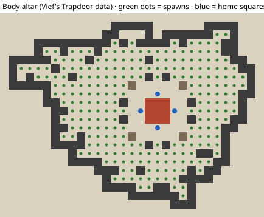

# Body altar: map and angles

> Generated by `tools/angle_atlas.py` from `data/altars/body.json`. Map data: Vief's Trapdoor GOP emulator (see [sources](../sources.md)); timings from the engine model in [05](../05-tick-engine.md). Not a Jagex source: treat as community data.



## The map

Legend: `A` altar (3×3, solid) · `.` floor · `*` floor tile that is an orb spawn point · `#` barrier (blocks orbs, players and sight) · `R` rock (blocks orbs and players, not sight) · `~` water/edge (blocks players only; orbs can cross it) · `|` wall on the tile's west edge · `_` wall on its south edge · `L` both · `/` `\` mini-pillars (block one diagonal through the tile). North is up; x grows east.

Spawn points: **246**. Grid: 53×53 tiles centred on the altar.

```text
          -15       -10        -5         0         5        10
  11  . . . . . . . . . . . . . . . . . . . . . . . . . . . . . . .
  10  . . . . . . . . . . . . . # # # # # . . . . . . # # # # . . .
   9  . . . . . . . . . . . . # # . . . # . # # # # # # * * # . . .
   8  . . . . # # # # # # # # # * # * # # # # * # * * * * # # . . .
   7  . . . . # * * # * * * # * * * * * * * * * * * * * * # # . . .
   6  . # # # # # * * * * # * * * * * * # * * * * * * * * * # # . .
   5  . # * * * * # * * * * * * * * * * * * * * * * * * * * * # # .
   4  . # . # * * * * # * * * * * * * * # * # * * * * * * * * * # .
   3  . # # # # # * * * * * * * * * R . . . . . R * * * * * * * # .
   2  . . . . . # * * * * * * * * * . . . . . . . * * * * * * # # .
   1  . . . . . # # * * * * * * * # . . A A A . . # * * * * * # . .
   0  . . . . . . # # * * * * * * * . . A A A . . * * * * * * # . .
  -1  . . . . . . # * * * * * * * # . . A A A . . # * * * * # # . .
  -2  . . . . . . # # * * * * * * * . . . . . . . * * * * # # . . .
  -3  . . . . . . # * * # * * * * * R . . . . . R * * * * # . . . .
  -4  . . . . . . # # # # * * * * * * * # * # * * * * * * # . . . .
  -5  . . . . . . . . # * * * * * * * * * * * * * * # # * # . . . .
  -6  . . . . . . . . # # # # * * * * * * * * * * * * * # # . . . .
  -7  . . . . . . . . . . . # # # * * # * * * * * # * # # . . . . .
  -8  . . . . . . . . . . . . # * * * * * * * * # # # # . . . . . .
  -9  . . . . . . . . . . . . # # # # * * # # * * # . . . . . . . .
 -10  . . . . . . . . . . . . . . . # # # # # # * # . . . . . . . .
 -11  . . . . . . . . . . . . . . . . . . . . # # # . . . . . . . .
 -12  . . . . . . . . . . . . . . . . . . . . . . . . . . . . . . .
```

## Standing still on each home square

The four home squares are the tiles in the middle of each side of the altar: N (0,2), E (2,0), S (0,-2) and W (-2,0). Each map shows where an orb could be and how long it takes to score it from that square without moving.

Legend: `P` you, standing still · `o` the scoring zone (an orb anywhere in the 5×5 square round the centre has scored) · digit/letter = ticks from your first click until the point registers, holding attract the whole time (0-9, then a=10, b=11, ...) · `#` within 10 tiles but out of sight · `x` in sight, but holding attract never scores: the orb either parks on the tile next to you outside the zone (it is 'behind' you) or stalls against scenery · `·` beyond the 10-tile reach · other symbols are scenery as on the map.

### Home square N (0, 2)

Spawn points you can score from here without moving: **66 of 246** (27%), mean 7.4 ticks. Hidden from here: 86. Visible but stall: 69. The rest are out of reach.

```text
          -15       -10        -5         0         5        10
  11  · · · · · · · · # # # # # # # # # # # # # # # # # # # # # · ·
  10  · · · · · · · · # # # # # # # # # # # # # # # # # # # # # · ·
   9  · · · · · · · · # # # # # # # # # # # # # # # # # x # # # · ·
   8  · · · · # # # # # # # # # x # # # # # # # # # # x x # # # · ·
   7  · · · · # · · # # # # # # x x # # # x x # # # x x x # # # · ·
   6  · # # # # # · · # # # x x # x # # # x # # # x x x x x # # · ·
   5  · # · · · · # · x x x x x x x x # # x # # x x x x x x x # # ·
   4  · # · # · · · · # x x x x x x x x # x # x x x x x x x x x # ·
   3  · # # # # # · · x x x x x x x R x x x x x R x x x x x x x # ·
   2  · · · · · # · · b a 9 8 7 6 5 4 o o P o o 4 5 6 7 8 9 a # # ·
   1  · · · · · # # · # # # # # # # 4 o A A A o 4 # # # # # x # · ·
   0  · · · · · · # # # # # # # 6 5 4 o A A A o 4 5 # # # # # # · ·
  -1  · · · · · · # · # # # 8 7 # # 4 o A A A o 4 # 7 7 # # # # · ·
  -2  · · · · · · # # b a 9 # # # 5 4 o o o o o 4 5 # # 8 # # # · ·
  -3  · · · · · · # · # # # # # 6 6 R 4 4 4 4 4 R 6 6 # # # # # · ·
  -4  · · · · · · # # # # # # 7 7 7 6 5 # 5 # 5 6 7 7 7 # # # # · ·
  -5  · · · · · · · · # # # 8 8 8 7 7 6 # 6 # # 7 7 # # 9 # # # · ·
  -6  · · · · · · · · # # # # 9 8 8 8 # # 7 # # 8 8 9 # # # # # · ·
  -7  · · · · · · · · # # # # # # 9 9 # # 8 # # 9 # # # # # # # · ·
  -8  · · · · · · · · # # # # # # a a # # 9 # # # # # # # # # # · ·
  -9  · · · · · · · · · · · · # # # # · · # # · · # · · · · · · · ·
 -10  · · · · · · · · · · · · · · · # # # # # # · # · · · · · · · ·
 -11  · · · · · · · · · · · · · · · · · · · · # # # · · · · · · · ·
 -12  · · · · · · · · · · · · · · · · · · · · · · · · · · · · · · ·
```

### Home square E (2, 0)

Spawn points you can score from here without moving: **71 of 246** (29%), mean 7.4 ticks. Hidden from here: 81. Visible but stall: 53. The rest are out of reach.

```text
          -15       -10        -5         0         5        10
  11  · · · · · · · · · · · · · · · · · · · · · · · · · · · · · · ·
  10  · · · · · · · · · · # # # # # # # # # # # # # # # # # # # # #
   9  · · · · · · · · · · # # # # # # # # # # # # # # # # x # # # #
   8  · · · · # # # # # # # # # # # # # # # # 9 # x x x x # # # # #
   7  · · · · # · · # · · # # 9 8 # # # # # # 8 x x x x x # # # # #
   6  · # # # # # · · · · # 9 9 8 7 # # # # # 7 x x x x x x # # # #
   5  · # · · · · # · · · a 9 8 8 7 6 # # 6 # 6 x x x x x # # # # #
   4  · # · # · · · · # · a 9 8 7 7 6 5 # 5 # 5 x x x x # # # # # #
   3  · # # # # # · · · · a 9 8 7 6 R 4 4 4 4 4 R x x # # # # # # #
   2  · · · · · # · · · · # # # 6 5 4 o o o o o x x # # # # # # # #
   1  · · · · · # # · · · # # # # # 4 o A A A o x # # # x x x # # #
   0  · · · · · · # # · · 9 8 7 6 5 4 o A A A P x x x x x x x # # #
  -1  · · · · · · # · · · # # # # # 4 o A A A o x # # # x x # # # #
  -2  · · · · · · # # · · # # # 6 5 4 o o o o o x x # # # # # # # #
  -3  · · · · · · # · · # a 9 8 7 6 R 4 4 4 4 4 R x x # # # # # # #
  -4  · · · · · · # # # # a 9 8 7 7 6 5 # 5 # 5 x x x x # # # # # #
  -5  · · · · · · · · # · a 9 8 8 7 6 # # 6 # 6 x x # # x # # # # #
  -6  · · · · · · · · # # # # 9 8 7 # # 7 # # 7 x x # # # # # # # #
  -7  · · · · · · · · · · # # # # # # # 8 # # 8 x # x # # # # # # #
  -8  · · · · · · · · · · # # # # # # # # # # 9 # # # # # # # # # #
  -9  · · · · · · · · · · # # # # # # # # # # a # # # # # # # # # #
 -10  · · · · · · · · · · # # # # # # # # # # # # # # # # # # # # #
 -11  · · · · · · · · · · · · · · · · · · · · # # # · · · · · · · ·
 -12  · · · · · · · · · · · · · · · · · · · · · · · · · · · · · · ·
```

### Home square S (0, -2)

Spawn points you can score from here without moving: **84 of 246** (34%), mean 7.8 ticks. Hidden from here: 96. Visible but stall: 44. The rest are out of reach.

```text
          -15       -10        -5         0         5        10
  11  · · · · · · · · · · · · · · · · · · · · · · · · · · · · · · ·
  10  · · · · · · · · · · · · · # # # # # · · · · · · # # # # · · ·
   9  · · · · · · · · · · · · # # · · · # · # # # # # # · · # · · ·
   8  · · · · # # # # # # # # # a # a # # # # # # a a a a # # # · ·
   7  · · · · # · · # # # # # 9 9 9 9 # # 8 # # 9 9 9 9 a # # # · ·
   6  · # # # # # · · # # # 9 9 8 8 8 # # 7 # # 8 8 8 9 9 9 # # · ·
   5  · # · · · · # · # # # 8 8 8 7 7 6 # 6 # # 7 7 8 8 8 # # # # ·
   4  · # · # · · · · # # # # 7 7 7 6 5 # 5 # 5 6 7 7 7 # # # b # ·
   3  · # # # # # · · b # # # # 6 6 R 4 4 4 4 4 R 6 6 # # # a b # ·
   2  · · · · · # · · b a 9 # # # 5 4 o o o o o 4 5 # # 8 9 # # # ·
   1  · · · · · # # · # # # 8 7 # # 4 o A A A o 4 # 7 7 # # # # · ·
   0  · · · · · · # # # # # # # 6 5 4 o A A A o 4 5 # # # # # # · ·
  -1  · · · · · · # · # # # # # # # 4 o A A A o 4 # # # # # # # · ·
  -2  · · · · · · # # b a 9 8 7 6 5 4 o o P o o 4 5 6 7 8 # # # · ·
  -3  · · · · · · # · # # x x x x x R x x x x x R x x x x # # # · ·
  -4  · · · · · · # # # # x x x x x x x # x # x x x x x x # # # · ·
  -5  · · · · · · · · # x x x x x x x # # x # # x x # # # # # # · ·
  -6  · · · · · · · · # # # # x # x # # # x # # # x # # # # # # · ·
  -7  · · · · · · · · # # # # # # x # # # x x # # # x # # # # # · ·
  -8  · · · · · · · · # # # # # # # # # # x x # # # # # # # # # · ·
  -9  · · · · · · · · # # # # # # # # # x # # # # # # # # # # # · ·
 -10  · · · · · · · · # # # # # # # # # # # # # # # # # # # # # · ·
 -11  · · · · · · · · # # # # # # # # # # # # # # # # # # # # # · ·
 -12  · · · · · · · · # # # # # # # # # # # # # # # # # # # # # · ·
```

### Home square W (-2, 0)

Spawn points you can score from here without moving: **69 of 246** (28%), mean 7.6 ticks. Hidden from here: 104. Visible but stall: 58. The rest are out of reach.

```text
          -15       -10        -5         0         5        10
  11  · · · · · · · · · · · · · · · · · · · · · · · · · · · · · · ·
  10  · · · · · · # # # # # # # # # # # # # # # # # # # # # # · · ·
   9  · · · · · · # # # # # # # # # x # # # # # # # # # b # # · · ·
   8  · · · · # # # # # # # # # x # x # # # # 9 # # # 9 a # # · · ·
   7  · · · · # · # # # # # # x x x x 8 # # # 8 # # 8 9 a # # · · ·
   6  · # # # # # # # # # # # x x x x 7 # # 7 # # 7 8 9 9 a # # · ·
   5  · # · · · · # # # # x x # x x x 6 # # 7 # 6 7 8 8 9 a · # # ·
   4  · # · # · · # # # # # x x x x x 5 # 5 # 5 6 7 7 8 9 a · · # ·
   3  · # # # # # # # # # # # # x x R 4 4 4 4 4 R 6 7 8 9 # · · # ·
   2  · · · · · # # # # # # # # # x x o o o o o 4 5 # # # # · # # ·
   1  · · · · · # # x x x # # # # # x o A A A o 4 # # # # # · # · ·
   0  · · · · · · # # x x x x x x x x P A A A o 4 5 6 7 8 9 · # · ·
  -1  · · · · · · # x x x # # # # # x o A A A o 4 # # # # # # # · ·
  -2  · · · · · · # # # # # # # # x x o o o o o 4 5 # # # # # · · ·
  -3  · · · · · · # # # # # # # x x R 4 4 4 4 4 R 6 7 8 9 # · · · ·
  -4  · · · · · · # # # # # x x x x x 5 # 5 # 5 6 7 7 8 9 # · · · ·
  -5  · · · · · · # # # # x x # x x x 6 # # 7 # 6 7 # # a # · · · ·
  -6  · · · · · · # # # # # # x x x x 7 # # 7 # # 7 # # # # · · · ·
  -7  · · · · · · # # # # # # # # x x # # # # 8 # # 9 # # # · · · ·
  -8  · · · · · · # # # # # # # # x x # # # # 9 # # # # # # · · · ·
  -9  · · · · · · # # # # # # # # # # # x # # # b # # # # # · · · ·
 -10  · · · · · · # # # # # # # # # # # # # # # c # # # # # · · · ·
 -11  · · · · · · · · · · · · · · · · · · · · # # # · · · · · · · ·
 -12  · · · · · · · · · · · · · · · · · · · · · · · · · · · · · · ·
```

## Four players, one on each home square

Each tile shows the fastest of the four. `·` means no home square scores it without moving: these are the orbs that need a walk, a relay (one player pulls it into someone else's angle) or a repel from behind.

Spawn points covered: **183 of 246** (74%), mean best time 7.8 ticks.

```text
          -15       -10        -5         0         5        10
  11  · · · · · · · · · · · · · · · · · · · · · · · · · · · · · · ·
  10  · · · · · · · · · · · · · # # # # # · · · · · · # # # # · · ·
   9  · · · · · · · · · · · · # # · · · # · # # # # # # b · # · · ·
   8  · · · · # # # # # # # # # a # a # # # # 9 # a a 9 a # # · · ·
   7  · · · · # · · # · · · # 9 8 9 9 8 · 8 · 8 9 9 8 9 a # # · · ·
   6  · # # # # # · · · · # 9 9 8 7 8 7 # 7 7 7 8 7 8 9 9 9 # # · ·
   5  · # · · · · # · · · a 8 8 8 7 6 6 · 6 7 6 6 7 8 8 8 a · # # ·
   4  · # · # · · · · # · a 9 7 7 7 6 5 # 5 # 5 6 7 7 7 9 a · b # ·
   3  · # # # # # · · b · a 9 8 6 6 R 4 4 4 4 4 R 6 6 8 9 · a b # ·
   2  · · · · · # · · b a 9 8 7 6 5 4 o o P o o 4 5 6 7 8 9 a # # ·
   1  · · · · · # # · · · · 8 7 · # 4 o A A A o 4 # 7 7 · · · # · ·
   0  · · · · · · # # · · 9 8 7 6 5 4 P A A A P 4 5 6 7 8 9 · # · ·
  -1  · · · · · · # · · · · 8 7 · # 4 o A A A o 4 # 7 7 · · # # · ·
  -2  · · · · · · # # b a 9 8 7 6 5 4 o o P o o 4 5 6 7 8 # # · · ·
  -3  · · · · · · # · · # a 9 8 6 6 R 4 4 4 4 4 R 6 6 8 9 # · · · ·
  -4  · · · · · · # # # # a 9 7 7 7 6 5 # 5 # 5 6 7 7 7 9 # · · · ·
  -5  · · · · · · · · # · a 8 8 8 7 6 6 · 6 7 6 6 7 # # 9 # · · · ·
  -6  · · · · · · · · # # # # 9 8 7 8 7 7 7 7 7 8 7 9 · # # · · · ·
  -7  · · · · · · · · · · · # # # 9 9 # 8 8 · 8 9 # 9 # # · · · · ·
  -8  · · · · · · · · · · · · # · a a · · 9 · 9 # # # # · · · · · ·
  -9  · · · · · · · · · · · · # # # # · · # # a b # · · · · · · · ·
 -10  · · · · · · · · · · · · · · · # # # # # # c # · · · · · · · ·
 -11  · · · · · · · · · · · · · · · · · · · · # # # · · · · · · · ·
 -12  · · · · · · · · · · · · · · · · · · · · · · · · · · · · · · ·
```
