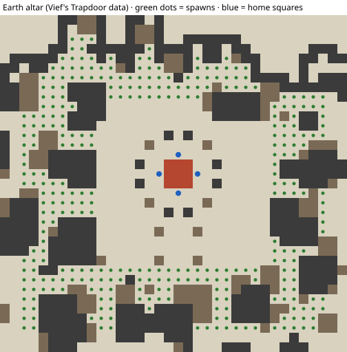

# Earth altar: map and angles

> Generated by `tools/angle_atlas.py` from `data/altars/earth.json`. Map data: Vief's Trapdoor GOP emulator (see [sources](../sources.md)); timings from the engine model in [05](../05-tick-engine.md). Not a Jagex source: treat as community data.



## The map

Legend: `A` altar (3×3, solid) · `.` floor · `*` floor tile that is an orb spawn point · `#` barrier (blocks orbs, players and sight) · `R` rock (blocks orbs and players, not sight) · `~` water/edge (blocks players only; orbs can cross it) · `|` wall on the tile's west edge · `_` wall on its south edge · `L` both · `/` `\` mini-pillars (block one diagonal through the tile). North is up; x grows east.

Spawn points: **316**. Grid: 53×53 tiles centred on the altar.

```text
          -15       -10        -5         0         5        10        15
  16  . . . . . . # # R R # . . # # . # . . . . . . . . . . . . . . . . . . .
  15  . . . . . . # . R R # . . # R R # . . . . . . . . . . . . . . . . . . .
  14  . . . . . . # * * * # . . # R R # . . # # # # # # . . . . . . . . . . .
  13  . . . . . # # * * # # # # # # * # # # # . # # . # # . . . . . . # # # .
  12  . # # # # # * * * * # * # # * * # R R # * # # * R # # . . . . # # . # #
  11  # # . # # * * * * * * * R # * * * R R # * * * * * * # . . . . # . . . .
  10  # . R R * * * * * * * * * * * * * * # * * * * * * * # # # # . # . # # #
   9  # # R R * * * # # # # * * * * * * * * * * * R * * * * R R # # # # # # #
   8  # # R R * * * # # # # * * * * * * * * * * R # # # # # R R * * * * * . #
   7  # # R R * * * * # # # . . . . . . . . . . R # # # # # R * * * * * * . .
   6  . . * * * * * # # # # . . . . . . . . . . . # # # # # R * R * # # * . .
   5  . . * * * * * # # # . . . . . . . . . . . . . . . . . . * * * # # * . .
   4  # . * * R R * * * * . . . . . . . # . # . . . . . . . . * * * * * * . .
   3  # . * * R R * * * * . . . . . R . . . . . R . . . . . . * * * * R R R .
   2  # . * R R # # # # # . . . . . . . . . . . . . . . . . . * * * R # # # .
   1  # . * R R # # # # # . . . . # . . A A A . . # . . . . . * # # # # # # #
   0  R . * * * # # # # # . . . . . . . A A A . . . . . . . . * # # # # # # #
  -1  . . * * * * * # # # . . . . # . . A A A . . # . . . . . * * * # # # R .
  -2  . . R R * * * * * * . . . . . . . . . . . . . . . . . . * * * * R * . .
  -3  R # # # * * * * * * . . . . . R . . . . . R . . . . . . # # # R R * . .
  -4  R # # # * * * * * * . . . . . . . # . # . . . . . . . . # # # R R * . .
  -5  # # # # * * # # # # . . . . . . . . . . . . . . . . . . # # # # # * . .
  -6  # # # # * R # # # # . . . . . . R . . . R . . . . . . . # # # # # * . .
  -7  # # # # * # # # # # . . . . . . . . . . . . . . . . . . * # # # # R R .
  -8  # # # * * # # # # # . . . . . . . . . . . . . . . . . . * * * * . R R .
  -9  . . * * * # # # # # R . . . . . R . . . R . . . . . . . * * * # # # # .
 -10  . . * * # # * * * * * * * * * * * * * * * * * * * * * R R * * # # # # R
 -11  . . * * * * * * * * * * * # * * * * * * * * * * R R * R R * * # # # # .
 -12  . . * * * * * R R * * * R R * R * * R R R R * * R # # # R * * # # # R .
 -13  . . * * # # # # R R * * R R * * * * R R R R * * # # # # * * * R * * . .
 -14  R . * * # # # # R R * * # # # * # # # # R R * * # # # # R R * * * * . .
 -15  R . * * # # # # # * * * # # # # # # # # R R * * # # # # R * * * * R R .
 -16  . . * * # # # # # R * * # # # # # # # # * * * * * * * R * * * * * R R .
 -17  . . . . R # # # # R . . # # # . . # # # . . . . . . . . . . # . . . . .
 -18  . . . . R # # # . . . . . . . . . . R # . . . # # # . . . # # # . . . .
```

## Standing still on each home square

The four home squares are the tiles in the middle of each side of the altar: N (0,2), E (2,0), S (0,-2) and W (-2,0). Each map shows where an orb could be and how long it takes to score it from that square without moving.

Legend: `P` you, standing still · `o` the scoring zone (an orb anywhere in the 5×5 square round the centre has scored) · digit/letter = ticks from your first click until the point registers, holding attract the whole time (0-9, then a=10, b=11, ...) · `#` within 10 tiles but out of sight · `x` in sight, but holding attract never scores: the orb either parks on the tile next to you outside the zone (it is 'behind' you) or stalls against scenery · `·` beyond the 10-tile reach · other symbols are scenery as on the map.

### Home square N (0, 2)

Spawn points you can score from here without moving: **5 of 316** (2%), mean 10.8 ticks. Hidden from here: 50. Visible but stall: 29. The rest are out of reach.

```text
          -15       -10        -5         0         5        10        15
  16  · · · · · · # # R R # · · # # · # · · · · · · · · · · · · · · · · · · ·
  15  · · · · · · # · R R # · · # R R # · · · · · · · · · · · · · · · · · · ·
  14  · · · · · · # · · · # · · # R R # · · # # # # # # · · · · · · · · · · ·
  13  · · · · · # # · · # # # # # # · # # # # · # # · # # · · · · · · # # # ·
  12  · # # # # # · · x x # # # # # # # R R # x # # # R # # # # · · # # · # #
  11  # # · # # · · · # x x x R # # # # R R # x # # # # # # # # · · # · · · ·
  10  # · R R · · · · # # x x # # # # # x # x # # # # # # # # # # · # · # # #
   9  # # R R · · · # # # # x x # # # # x x x # # R # # # # R R # # # # # # #
   8  # # R R · · · # # # # # x x # # # # x x # R # # # # # R R · · · · · · #
   7  # # R R · · · · # # # x # x x # # # x x # R # # # # # R # · · · · · · ·
   6  · · · · · · · # # # # x x # x # # # x # # # # # # # # R x R · # # · · ·
   5  · · · · · · · # # # x x x x x x # # x # # x x x x x x x x · · # # · · ·
   4  # · · · R R · · x x x x x x x x x # x # x x x x x x x x x · · · · · · ·
   3  # · · · R R · · x x x x x x x R x x x x x R x x x x x x x · · · R R R ·
   2  # · · R R # # # # # 9 8 7 6 5 4 o o P o o 4 5 6 7 8 9 a b · · R # # # ·
   1  # · · R R # # # # # # # # # # 4 o A A A o 4 # # # # # x x # # # # # # #
   0  R · · · · # # # # # # # # 6 5 4 o A A A o 4 5 # # # # # # # # # # # # #
  -1  · · · · · · · # # # # 8 7 # # 4 o A A A o 4 # 7 7 # # # # · · # # # R ·
  -2  · · R R · · · · b a 9 # # # 5 4 o o o o o 4 5 # # 8 9 # # · · · R · · ·
  -3  R # # # · · · · b # # # # 6 6 R 4 4 4 4 4 R 6 6 # # # a # # # R R · · ·
  -4  R # # # · · · · # # # # 7 7 7 6 5 # 5 # 5 6 7 7 7 # # # # # # R R · · ·
  -5  # # # # · · # # # # # 8 8 8 7 7 6 # 6 # # 7 7 8 8 8 # # # # # # # · · ·
  -6  # # # # · R # # # # 9 9 9 8 8 8 R # 7 # R 8 8 8 9 9 9 # # # # # # · · ·
  -7  # # # # · # # # # # # a 9 9 9 9 # # 8 # # 9 9 9 9 a a a # # # # # R R ·
  -8  # # # · · # # # # # b a a a a a # # 9 # # # a a a a b b b · · · · R R ·
  -9  · · · · · # # # # # R · · · · · R · · · R · · · · · · · · · · # # # # ·
 -10  · · · · # # · · · · · · · · · · · · · · · · · · · · · R R · · # # # # R
 -11  · · · · · · · · · · · · · # · · · · · · · · · · R R · R R · · # # # # ·
 -12  · · · · · · · R R · · · R R · R · · R R R R · · R # # # R · · # # # R ·
 -13  · · · · # # # # R R · · R R · · · · R R R R · · # # # # · · · R · · · ·
 -14  R · · · # # # # R R · · # # # · # # # # R R · · # # # # R R · · · · · ·
 -15  R · · · # # # # # · · · # # # # # # # # R R · · # # # # R · · · · R R ·
 -16  · · · · # # # # # R · · # # # # # # # # · · · · · · · R · · · · · R R ·
 -17  · · · · R # # # # R · · # # # · · # # # · · · · · · · · · · # · · · · ·
 -18  · · · · R # # # · · · · · · · · · · R # · · · # # # · · · # # # · · · ·
```

### Home square E (2, 0)

Spawn points you can score from here without moving: **14 of 316** (4%), mean 10.4 ticks. Hidden from here: 54. Visible but stall: 25. The rest are out of reach.

```text
          -15       -10        -5         0         5        10        15
  16  · · · · · · # # R R # · · # # · # · · · · · · · · · · · · · · · · · · ·
  15  · · · · · · # · R R # · · # R R # · · · · · · · · · · · · · · · · · · ·
  14  · · · · · · # · · · # · · # R R # · · # # # # # # · · · · · · · · · · ·
  13  · · · · · # # · · # # # # # # · # # # # · # # · # # · · · · · · # # # ·
  12  · # # # # # · · · · # · # # · · # R R # · # # · R # # · · · · # # · # #
  11  # # · # # · · · · · · · R # · · · R R # · · · · · · # · · · · # · · · ·
  10  # · R R · · · · · · c b # # # b b # # # b x # # # # # # # # # # · # # #
   9  # # R R · · · # # # # a a # # # a # # # a x R # # # # R R # # # # # # #
   8  # # R R · · · # # # # # 9 # # # 9 # # # 9 R # # # # # R R # # · · · · #
   7  # # R R · · · · # # # a 9 8 # # # 8 # # 8 R # # # # # R # # # · · · · ·
   6  · · · · · · · # # # # 9 9 8 7 # # 7 # # 7 x # # # # # R # R # # # · · ·
   5  · · · · · · · # # # a 9 8 8 7 6 # # 6 # 6 x x x x x # # # # # # # · · ·
   4  # · · · R R · · · · a 9 8 7 7 6 5 # 5 # 5 x x x x # # # # # # · · · · ·
   3  # · · · R R · · · · a 9 8 7 6 R 4 4 4 4 4 R x x # # # # # # # · R R R ·
   2  # · · R R # # # # # # # # 6 5 4 o o o o o x x # # # # # # x x R # # # ·
   1  # · · R R # # # # # # # # # # 4 o A A A o x # # # x x x x # # # # # # #
   0  R · · · · # # # # # 9 8 7 6 5 4 o A A A P x x x x x x x x # # # # # # #
  -1  · · · · · · · # # # # # # # # 4 o A A A o x # # # x x x x x x # # # R ·
  -2  · · R R · · · · · · # # # 6 5 4 o o o o o x x # # # # # # x x · R · · ·
  -3  R # # # · · · · · · a 9 8 7 6 R 4 4 4 4 4 R x x # # # # # # # R R · · ·
  -4  R # # # · · · · · · a 9 8 7 7 6 5 # 5 # 5 x x x x # # # # # # R R · · ·
  -5  # # # # · · # # # # a 9 8 8 7 6 # # 6 # 6 x x x x x # # # # # # # · · ·
  -6  # # # # · R # # # # a 9 9 8 7 # R 7 # # R x x x x x x # # # # # # · · ·
  -7  # # # # · # # # # # a a 9 8 # # # 8 # # x x x x x x x x # # # # # R R ·
  -8  # # # · · # # # # # b # 9 # # # 9 # # # x x x x x x x x x # # · · R R ·
  -9  · · · · · # # # # # R a a # # # R # # # R x x x x x x x x x # # # # # ·
 -10  · · · · # # · · · · c b # # # x x # # # x x x x x x x R R x x # # # # R
 -11  · · · · · · · · · · · · · # · · · · · · · · · · R R · R R · · # # # # ·
 -12  · · · · · · · R R · · · R R · R · · R R R R · · R # # # R · · # # # R ·
 -13  · · · · # # # # R R · · R R · · · · R R R R · · # # # # · · · R · · · ·
 -14  R · · · # # # # R R · · # # # · # # # # R R · · # # # # R R · · · · · ·
 -15  R · · · # # # # # · · · # # # # # # # # R R · · # # # # R · · · · R R ·
 -16  · · · · # # # # # R · · # # # # # # # # · · · · · · · R · · · · · R R ·
 -17  · · · · R # # # # R · · # # # · · # # # · · · · · · · · · · # · · · · ·
 -18  · · · · R # # # · · · · · · · · · · R # · · · # # # · · · # # # · · · ·
```

### Home square S (0, -2)

Spawn points you can score from here without moving: **11 of 316** (3%), mean 10.3 ticks. Hidden from here: 41. Visible but stall: 24. The rest are out of reach.

```text
          -15       -10        -5         0         5        10        15
  16  · · · · · · # # R R # · · # # · # · · · · · · · · · · · · · · · · · · ·
  15  · · · · · · # · R R # · · # R R # · · · · · · · · · · · · · · · · · · ·
  14  · · · · · · # · · · # · · # R R # · · # # # # # # · · · · · · · · · · ·
  13  · · · · · # # · · # # # # # # · # # # # · # # · # # · · · · · · # # # ·
  12  · # # # # # · · · · # · # # · · # R R # · # # · R # # · · · · # # · # #
  11  # # · # # · · · · · · · R # · · · R R # · · · · · · # · · · · # · · · ·
  10  # · R R · · · · · · · · · · · · · · # · · · · · · · # # # # · # · # # #
   9  # # R R · · · # # # # · · · · · · · · · · · R · · · · R R # # # # # # #
   8  # # R R · · · # # # # a a a a a # # 9 # # R # # # # # R R · · · · · · #
   7  # # R R · · · · # # # a 9 9 9 9 # # 8 # # R # # # # # R # · · · · · · ·
   6  · · · · · · · # # # # 9 9 8 8 8 # # 7 # # 8 # # # # # R # R · # # · · ·
   5  · · · · · · · # # # # 8 8 8 7 7 6 # 6 # # 7 7 8 8 8 # # # · · # # · · ·
   4  # · · · R R · · # # # # 7 7 7 6 5 # 5 # 5 6 7 7 7 # # # b · · · · · · ·
   3  # · · · R R · · # # # # # 6 6 R 4 4 4 4 4 R 6 6 # # # a b · · · R R R ·
   2  # · · R R # # # # # 9 # # # 5 4 o o o o o 4 5 # # 8 9 # # · · R # # # ·
   1  # · · R R # # # # # # 8 7 # # 4 o A A A o 4 # 7 7 # # # # # # # # # # #
   0  R · · · · # # # # # # # # 6 5 4 o A A A o 4 5 # # # # # # # # # # # # #
  -1  · · · · · · · # # # # # # # # 4 o A A A o 4 # # # # # x x · · # # # R ·
  -2  · · R R · · · · b a 9 8 7 6 5 4 o o P o o 4 5 6 7 8 9 a b · · · R · · ·
  -3  R # # # · · · · x x x x x x x R x x x x x R x x x x x x # # # R R · · ·
  -4  R # # # · · · · x x x x x x x x x # x # x x x x x x x x # # # R R · · ·
  -5  # # # # · · # # # # x x x x x x # # x # # x x x x x x x # # # # # · · ·
  -6  # # # # · R # # # # x x x # x # R # x # R # x x x x x x # # # # # · · ·
  -7  # # # # · # # # # # x x # x x # # # x x # # # x x x x x x # # # # R R ·
  -8  # # # · · # # # # # x # x x # # # # x x # # # # x x x x x · · · · R R ·
  -9  · · · · · # # # # # R x x # # # R x x x R # # # # x x x x · · # # # # ·
 -10  · · · · # # · · # # x x # # # # # x x x # # # # # # x R R · · # # # # R
 -11  · · · · · · · · # x x x # # # # # x x x x # # # R R # R R · · # # # # ·
 -12  · · · · · · · R R x x # R R # R # x R R R R # # R # # # R · · # # # R ·
 -13  · · · · # # # # R R · · R R · · · · R R R R · · # # # # · · · R · · · ·
 -14  R · · · # # # # R R · · # # # · # # # # R R · · # # # # R R · · · · · ·
 -15  R · · · # # # # # · · · # # # # # # # # R R · · # # # # R · · · · R R ·
 -16  · · · · # # # # # R · · # # # # # # # # · · · · · · · R · · · · · R R ·
 -17  · · · · R # # # # R · · # # # · · # # # · · · · · · · · · · # · · · · ·
 -18  · · · · R # # # · · · · · · · · · · R # · · · # # # · · · # # # · · · ·
```

### Home square W (-2, 0)

Spawn points you can score from here without moving: **9 of 316** (3%), mean 10.7 ticks. Hidden from here: 57. Visible but stall: 26. The rest are out of reach.

```text
          -15       -10        -5         0         5        10        15
  16  · · · · · · # # R R # · · # # · # · · · · · · · · · · · · · · · · · · ·
  15  · · · · · · # · R R # · · # R R # · · · · · · · · · · · · · · · · · · ·
  14  · · · · · · # · · · # · · # R R # · · # # # # # # · · · · · · · · · · ·
  13  · · · · · # # · · # # # # # # · # # # # · # # · # # · · · · · · # # # ·
  12  · # # # # # · · · · # · # # · · # R R # · # # · R # # · · · · # # · # #
  11  # # · # # · · · · · · · R # · · · R R # · · · · · · # · · · · # · · · ·
  10  # · R R · · # # # # # x x x x x b x # # # b c # # # # # # # · # · # # #
   9  # # R R · · # # # # # x x x x x a x # # # b R # # # # R R # # # # # # #
   8  # # R R · · # # # # # x x x x x 9 # # # 9 R # # # # # R R · · · · · · #
   7  # # R R · · # # # # # x x x x x 8 # # # 8 R # # # # # R · · · · · · · ·
   6  · · · · · · # # # # # # x x x x 7 # # 7 # # # # # # # R · R · # # · · ·
   5  · · · · · · # # # # x x # x x x 6 # # 7 # 6 7 8 8 9 a · · · · # # · · ·
   4  # · · · R R # # # # # x x x x x 5 # 5 # 5 6 7 7 8 9 a · · · · · · · · ·
   3  # · · · R R # # # # # # # x x R 4 4 4 4 4 R 6 7 8 9 # · · · · · R R R ·
   2  # · · R R # # # # # # # # # x x o o o o o 4 5 # # # # · · · · R # # # ·
   1  # · · R R # # # # # # # # # # x o A A A o 4 # # # # # · · # # # # # # #
   0  R · · · · # # # # # x x x x x x P A A A o 4 5 6 7 8 9 · · # # # # # # #
  -1  · · · · · · # # # # # # # # # x o A A A o 4 # # # # # · · · · # # # R ·
  -2  · · R R · · # # # # # # # # x x o o o o o 4 5 # # # # · · · · · R · · ·
  -3  R # # # · · # # # # # # # x x R 4 4 4 4 4 R 6 7 8 9 # · # # # R R · · ·
  -4  R # # # · · # # # # # x x x x x 5 # 5 # 5 6 7 7 8 9 a · # # # R R · · ·
  -5  # # # # · · # # # # x x # x x x 6 # # 7 # 6 7 8 8 9 a · # # # # # · · ·
  -6  # # # # · R # # # # x # x x x x R # # 7 R # 7 8 9 9 a · # # # # # · · ·
  -7  # # # # · # # # # # # x x x x x x # # # 9 # # 8 9 a a · · # # # # R R ·
  -8  # # # · · # # # # # x x x x x x x # # # 9 # # # 9 a b · · · · · · R R ·
  -9  · · · · · # # # # # R x x x x x R x # # R b # # # a b · · · · # # # # ·
 -10  · · · · # # # # # # x x x x x x x x # # # x c # # # b R R · · # # # # R
 -11  · · · · · · · · · · · · · # · · · · · · · · · · R R · R R · · # # # # ·
 -12  · · · · · · · R R · · · R R · R · · R R R R · · R # # # R · · # # # R ·
 -13  · · · · # # # # R R · · R R · · · · R R R R · · # # # # · · · R · · · ·
 -14  R · · · # # # # R R · · # # # · # # # # R R · · # # # # R R · · · · · ·
 -15  R · · · # # # # # · · · # # # # # # # # R R · · # # # # R · · · · R R ·
 -16  · · · · # # # # # R · · # # # # # # # # · · · · · · · R · · · · · R R ·
 -17  · · · · R # # # # R · · # # # · · # # # · · · · · · · · · · # · · · · ·
 -18  · · · · R # # # · · · · · · · · · · R # · · · # # # · · · # # # · · · ·
```

## Four players, one on each home square

Each tile shows the fastest of the four. `·` means no home square scores it without moving: these are the orbs that need a walk, a relay (one player pulls it into someone else's angle) or a repel from behind.

Spawn points covered: **32 of 316** (10%), mean best time 10.6 ticks.

```text
          -15       -10        -5         0         5        10        15
  16  · · · · · · # # R R # · · # # · # · · · · · · · · · · · · · · · · · · ·
  15  · · · · · · # · R R # · · # R R # · · · · · · · · · · · · · · · · · · ·
  14  · · · · · · # · · · # · · # R R # · · # # # # # # · · · · · · · · · · ·
  13  · · · · · # # · · # # # # # # · # # # # · # # · # # · · · · · · # # # ·
  12  · # # # # # · · · · # · # # · · # R R # · # # · R # # · · · · # # · # #
  11  # # · # # · · · · · · · R # · · · R R # · · · · · · # · · · · # · · · ·
  10  # · R R · · · · · · c b · · · b b · # · b b c · · · # # # # · # · # # #
   9  # # R R · · · # # # # a a · · · a · · · a b R · · · · R R # # # # # # #
   8  # # R R · · · # # # # a 9 a a a 9 · 9 · 9 R # # # # # R R · · · · · · #
   7  # # R R · · · · # # # a 9 8 9 9 8 8 8 · 8 R # # # # # R · · · · · · · ·
   6  · · · · · · · # # # # 9 9 8 7 8 7 7 7 7 7 8 # # # # # R · R · # # · · ·
   5  · · · · · · · # # # a 8 8 8 7 6 6 · 6 7 6 6 7 8 8 8 a · · · · # # · · ·
   4  # · · · R R · · · · a 9 7 7 7 6 5 # 5 # 5 6 7 7 7 9 a · b · · · · · · ·
   3  # · · · R R · · · · a 9 8 6 6 R 4 4 4 4 4 R 6 6 8 9 · a b · · · R R R ·
   2  # · · R R # # # # # 9 8 7 6 5 4 o o P o o 4 5 6 7 8 9 a b · · R # # # ·
   1  # · · R R # # # # # · 8 7 · # 4 o A A A o 4 # 7 7 · · · · # # # # # # #
   0  R · · · · # # # # # 9 8 7 6 5 4 P A A A P 4 5 6 7 8 9 · · # # # # # # #
  -1  · · · · · · · # # # · 8 7 · # 4 o A A A o 4 # 7 7 · · · · · · # # # R ·
  -2  · · R R · · · · b a 9 8 7 6 5 4 o o P o o 4 5 6 7 8 9 a b · · · R · · ·
  -3  R # # # · · · · b · a 9 8 6 6 R 4 4 4 4 4 R 6 6 8 9 · a # # # R R · · ·
  -4  R # # # · · · · · · a 9 7 7 7 6 5 # 5 # 5 6 7 7 7 9 a · # # # R R · · ·
  -5  # # # # · · # # # # a 8 8 8 7 6 6 · 6 7 6 6 7 8 8 8 a · # # # # # · · ·
  -6  # # # # · R # # # # 9 9 9 8 7 8 R 7 7 7 R 8 7 8 9 9 9 · # # # # # · · ·
  -7  # # # # · # # # # # a a 9 8 9 9 · 8 8 · 9 9 9 8 9 a a a · # # # # R R ·
  -8  # # # · · # # # # # b a 9 a a a 9 · 9 · 9 · a a 9 a b b b · · · · R R ·
  -9  · · · · · # # # # # R a a · · · R · · · R b · · · a b · · · · # # # # ·
 -10  · · · · # # · · · · c b · · · · · · · · · · c · · · b R R · · # # # # R
 -11  · · · · · · · · · · · · · # · · · · · · · · · · R R · R R · · # # # # ·
 -12  · · · · · · · R R · · · R R · R · · R R R R · · R # # # R · · # # # R ·
 -13  · · · · # # # # R R · · R R · · · · R R R R · · # # # # · · · R · · · ·
 -14  R · · · # # # # R R · · # # # · # # # # R R · · # # # # R R · · · · · ·
 -15  R · · · # # # # # · · · # # # # # # # # R R · · # # # # R · · · · R R ·
 -16  · · · · # # # # # R · · # # # # # # # # · · · · · · · R · · · · · R R ·
 -17  · · · · R # # # # R · · # # # · · # # # · · · · · · · · · · # · · · · ·
 -18  · · · · R # # # · · · · · · · · · · R # · · · # # # · · · # # # · · · ·
```
