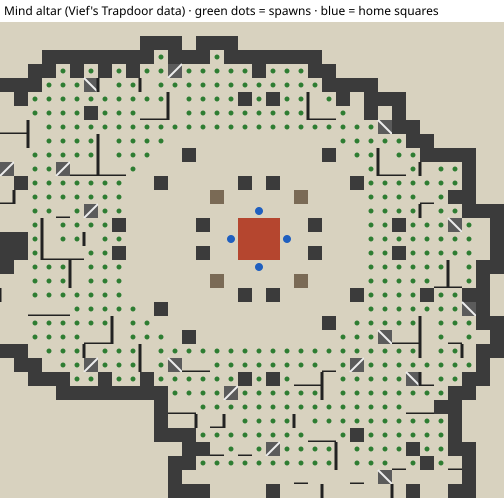

# Mind altar: map and angles

> Generated by `tools/angle_atlas.py` from `data/altars/mind.json`. Map data: Vief's Trapdoor GOP emulator (see [sources](../sources.md)); timings from the engine model in [05](../05-tick-engine.md). Not a Jagex source: treat as community data.



## The map

Legend: `A` altar (3×3, solid) · `.` floor · `*` floor tile that is an orb spawn point · `#` barrier (blocks orbs, players and sight) · `R` rock (blocks orbs and players, not sight) · `~` water/edge (blocks players only; orbs can cross it) · `|` wall on the tile's west edge · `_` wall on its south edge · `L` both · `/` `\` mini-pillars (block one diagonal through the tile). North is up; x grows east.

Spawn points: **520**. Grid: 53×53 tiles centred on the altar.

```text
          -15       -10        -5         0         5        10        15
  15  . . . . . . . . . . . . . . . . . . . . . . . . . . . . . . . . . . . .
  14  . . . . . . . . . . # # # . # # # . . . . . . . . . . . . . . . . . . .
  13  . . . # # # # # # # # * # # # * # # # # # # # . . . . . . . . . . . . .
  12  . . # # * # * # * # * * / * * * * * # * * * # # . . . . . . . . . . . .
  11  # # # * * * \ | * * | * * * * * * * * * * * * # # # # . . . . . . . . .
  10  . # * * * * * * * * * * | * * * * # * # * * | * # . # # # . . . . . . .
   9  . . * * * * # * * * _ _ | * * * * * * * * * L _ * . # . # . . . . . . .
   8  _ _ | * * * * * * * * * * * * * * * * * * * * * * * * \ # # . . . . . .
   7  . . | * * * * | * * * * . . . . . . . . . . . . * * * * * # # . . . . .
   6  . . * * * * * | * * * . . # . . . . . . . . . # . * * | * * # # # # . .
   5  / . * * / _ _ L _ * . . . . . . . . . . . . . . . . * L _ * | * * # . .
   4  . # * * * * * * * . . # . . . . . # . # . . . . . # * * * * * * * # . .
   3  _ | * * * * * * * . . . . . . R . . . . . R . . . . * * * * _ * # # . .
   2  . . * * _ * / * * . . . . . . . . . . . . . . . . . * * * * | * * # # #
   1  . . * | * * * * # . . . . . # . . A A A . . # . . . * * # * * * \ * . #
   0  # # * | * * | * * . . . . . . . . A A A . . . . . . * * * * * * * * . #
  -1  # # * L _ _ * * # . . . . . # . . A A A . . # . . . * * # * * * * * . #
  -2  # . * * * | * * * . . . . . . . . . . . . . . . . . * * * * * * | * # #
  -3  . . * * * | * * * . . . . . . R . . . . . R . . . . * * * * * _ L * # .
  -4  | . * * * * * * * . . . . . . . . # . # . . . . . # * * * * # * * # # .
  -5  . . _ _ _ * * * * * . # . . . . . . . . . . . . . . * * * * * * * \ # .
  -6  . . * * * * * * | * * . . . . . . . . . . . . # . * * * * * | * * * # #
  -7  . . * * * * _ _ | * * * . # . . . . . . . . . . * * * \ _ _ | * _ * . #
  -8  # # . * * * | * * * | * * * * * * * * * * * * * * * * * * * | * * | # #
  -9  . # # . * * / * * * | * \ _ _ * * * * * * * * _ * / * * * * * * * * # .
 -10  . . # # # * * # * * # * * * * * * # * # * _ _ | * * * * * \ L * * # # .
 -11  . . . . # # # # # # # # * * * * / * * * * * * | * * * * * * * * # # . .
 -12  . . . . . . . . . . . # _ _ * * * * * * * * * * * * * * * _ _ # # . . .
 -13  . . . . . . . . . . . # . . | _ | * * * * | * * * * * * * * * * # . . .
 -14  . . . . . . . . . . . # # # * * * * * * * * _ _ * # * * * * * * # . . .
 -15  . . . . . . . . . . . . . # # _ * _ * / * * * * | * * * * # * * # # . .
 -16  . . . . . . . . . . . . # # * * * * * * * * * * | * * * _ * # * _ # . .
 -17  . . . . . . . . . . . . # . . . . . . . . _ . . . _ . \ . . . . . # . .
 -18  . . . . . . . . . . . . # # # . . . . # . . . | . . . . | # . . # # . .
```

## Standing still on each home square

The four home squares are the tiles in the middle of each side of the altar: N (0,2), E (2,0), S (0,-2) and W (-2,0). Each map shows where an orb could be and how long it takes to score it from that square without moving.

Legend: `P` you, standing still · `o` the scoring zone (an orb anywhere in the 5×5 square round the centre has scored) · digit/letter = ticks from your first click until the point registers, holding attract the whole time (0-9, then a=10, b=11, ...) · `#` within 10 tiles but out of sight · `x` in sight, but holding attract never scores: the orb either parks on the tile next to you outside the zone (it is 'behind' you) or stalls against scenery · `·` beyond the 10-tile reach · other symbols are scenery as on the map.

### Home square N (0, 2)

Spawn points you can score from here without moving: **23 of 520** (4%), mean 10.3 ticks. Hidden from here: 106. Visible but stall: 25. The rest are out of reach.

```text
          -15       -10        -5         0         5        10        15
  15  · · · · · · · · · · · · · · · · · · · · · · · · · · · · · · · · · · · ·
  14  · · · · · · · · · · # # # · # # # · · · · · · · · · · · · · · · · · · ·
  13  · · · # # # # # # # # · # # # · # # # # # # # · · · · · · · · · · · · ·
  12  · · # # · # · # # # # # / # # # # # # # # # # # # # # # # · · · · · · ·
  11  # # # · · · \ | # # | # # # # # # # x # x # # # # # # # # · · · · · · ·
  10  · # · · · · · · # # # # | # # # # # x # # # | # # # # # # · · · · · · ·
   9  · · · · · · # · # # _ _ | # # # # x x x # # L _ # x # # # · · · · · · ·
   8  _ _ | · · · · · # # # # x x # # # # x x # # # # x # # \ # # · · · · · ·
   7  · · | · · · · | x x # # # x x # # # x x # # # x # # x # # # # · · · · ·
   6  · · · · · · · | x x x x # # x # # # x # # # x # x x x | # · # # # # · ·
   5  / · · · / _ _ L _ # x x x x x x # # x # # x x x x x # L _ · | · · # · ·
   4  · # · · · · · · # # # # x x x x x # x # x x x x x # # # x · · · · # · ·
   3  _ | · · · · · · x x x x x x x R x x x x x R x x x x x x x · _ · # # · ·
   2  · · · · _ · / · b a 9 8 7 6 5 4 o o P o o 4 5 6 7 8 9 a b · | · · # # #
   1  · · · | · · · · # # # # # # # 4 o A A A o 4 # # # # # x # · · · \ · · #
   0  # # · | · · | · # # # # # 6 5 4 o A A A o 4 5 # # # # # # · · · · · · #
  -1  # # · L _ _ · · # # # 8 7 # # 4 o A A A o 4 # 7 7 # # # # · · · · · · #
  -2  # · · · · | · · b a 9 # # # 5 4 o o o o o 4 5 # # 8 9 # # · · · | · # #
  -3  · · · · · | · · b # # # # 6 6 R 4 4 4 4 4 R 6 6 # # # a b · · _ L · # ·
  -4  | · · · · · · · # # # # 7 7 7 6 5 # 5 # 5 6 7 7 7 # # # b · # · · # # ·
  -5  · · _ _ _ · · · # # # # 8 8 7 7 6 # 6 # # 7 7 8 8 9 # # # · · · · \ # ·
  -6  · · · · · · · · | # # # 9 8 8 8 # # 7 # # 8 8 # # 9 a # # · | · · · # #
  -7  · · · · · · _ _ | # # a a # 9 9 # # 8 # # 9 9 a # # a \ _ _ | · _ · · #
  -8  # # · · · · | · # # | b # # a a # # 9 # # # a a # # b b c · | · · | # #
  -9  · # # · · · / · · · | · \ _ _ · · · · · · · · _ · / · · · · · · · · # ·
 -10  · · # # # · · # · · # · · · · · · # · # · _ _ | · · · · · \ L · · # # ·
 -11  · · · · # # # # # # # # · · · · / · · · · · · | · · · · · · · · # # · ·
 -12  · · · · · · · · · · · # _ _ · · · · · · · · · · · · · · · _ _ # # · · ·
 -13  · · · · · · · · · · · # · · | _ | · · · · | · · · · · · · · · · # · · ·
 -14  · · · · · · · · · · · # # # · · · · · · · · _ _ · # · · · · · · # · · ·
 -15  · · · · · · · · · · · · · # # _ · _ · / · · · · | · · · · # · · # # · ·
 -16  · · · · · · · · · · · · # # · · · · · · · · · · | · · · _ · # · _ # · ·
 -17  · · · · · · · · · · · · # · · · · · · · · _ · · · _ · \ · · · · · # · ·
 -18  · · · · · · · · · · · · # # # · · · · # · · · | · · · · | # · · # # · ·
```

### Home square E (2, 0)

Spawn points you can score from here without moving: **18 of 520** (3%), mean 10.2 ticks. Hidden from here: 97. Visible but stall: 39. The rest are out of reach.

```text
          -15       -10        -5         0         5        10        15
  15  · · · · · · · · · · · · · · · · · · · · · · · · · · · · · · · · · · · ·
  14  · · · · · · · · · · # # # · # # # · · · · · · · · · · · · · · · · · · ·
  13  · · · # # # # # # # # · # # # · # # # # # # # · · · · · · · · · · · · ·
  12  · · # # · # · # · # · · / · · · · · # · · · # # · · · · · · · · · · · ·
  11  # # # · · · \ | · · | · · · · · · · · · · · · # # # # · · · · · · · · ·
  10  · # · · · · · · · · # # | # # b b # # # b x | # # # # # # # # · · · · ·
   9  · · · · · · # · · · _ _ | # # # a # # # a x L _ # # # # # # # · · · · ·
   8  _ _ | · · · · · · · # # a # # # 9 # # # 9 x x x # # x \ # # # · · · · ·
   7  · · | · · · · | · · # # # 9 # # # 8 # # 8 x x # # x x x # # # · · · · ·
   6  · · · · · · · | · · a 9 # # 7 # # 7 # # 7 x x # # x x | # # # # # # · ·
   5  / · · · / _ _ L _ · # 9 8 8 7 6 # # 6 # 6 x x x x x # L _ # | · · # · ·
   4  · # · · · · · · · · # # 8 7 7 6 5 # 5 # 5 x x x x # # # # # # · · # · ·
   3  _ | · · · · · · · · a 9 8 7 6 R 4 4 4 4 4 R x x # # # # # # _ · # # · ·
   2  · · · · _ · / · · · # # # 6 5 4 o o o o o x x # # # # # # x | · · # # #
   1  · · · | · · · · # · # # # # # 4 o A A A o x # # # x x x # # # · \ · · #
   0  # # · | · · | · · · 9 8 7 6 5 4 o A A A P x x x x x x x x x x · · · · #
  -1  # # · L _ _ · · # · # # # # # 4 o A A A o x # # # x x x # # # · · · · #
  -2  # · · · · | · · · · # # # 6 5 4 o o o o o x x # # # # # # x # · | · # #
  -3  · · · · · | · · · · a 9 8 7 6 R 4 4 4 4 4 R x x # # # # # # # _ L · # ·
  -4  | · · · · · · · · · a 9 8 7 7 6 5 # 5 # 5 x x x x # # # # # # · · # # ·
  -5  · · _ _ _ · · · · · # # 8 8 7 6 # # 6 # 6 x x x x x # # # # # · · \ # ·
  -6  · · · · · · · · | · # a 9 8 7 # # 7 # # 7 x x # # x x # # # | · · · # #
  -7  · · · · · · _ _ | · b a # # # # # 8 # # 8 x x # # x x \ _ _ | · _ · · #
  -8  # # · · · · | · · · | # # # # # 9 # # # 9 x x x # # x x x # | · · | # #
  -9  · # # · · · / · · · | # \ _ _ # a # # # a x x _ # / # x x x # · · · # ·
 -10  · · # # # · · # · · # # # # # b b # # # b _ _ | x # # # x \ L · · # # ·
 -11  · · · · # # # # # # # # · · · · / · · · · · · | · · · · · · · · # # · ·
 -12  · · · · · · · · · · · # _ _ · · · · · · · · · · · · · · · _ _ # # · · ·
 -13  · · · · · · · · · · · # · · | _ | · · · · | · · · · · · · · · · # · · ·
 -14  · · · · · · · · · · · # # # · · · · · · · · _ _ · # · · · · · · # · · ·
 -15  · · · · · · · · · · · · · # # _ · _ · / · · · · | · · · · # · · # # · ·
 -16  · · · · · · · · · · · · # # · · · · · · · · · · | · · · _ · # · _ # · ·
 -17  · · · · · · · · · · · · # · · · · · · · · _ · · · _ · \ · · · · · # · ·
 -18  · · · · · · · · · · · · # # # · · · · # · · · | · · · · | # · · # # · ·
```

### Home square S (0, -2)

Spawn points you can score from here without moving: **27 of 520** (5%), mean 10.3 ticks. Hidden from here: 107. Visible but stall: 31. The rest are out of reach.

```text
          -15       -10        -5         0         5        10        15
  15  · · · · · · · · · · · · · · · · · · · · · · · · · · · · · · · · · · · ·
  14  · · · · · · · · · · # # # · # # # · · · · · · · · · · · · · · · · · · ·
  13  · · · # # # # # # # # · # # # · # # # # # # # · · · · · · · · · · · · ·
  12  · · # # · # · # · # · · / · · · · · # · · · # # · · · · · · · · · · · ·
  11  # # # · · · \ | · · | · · · · · · · · · · · · # # # # · · · · · · · · ·
  10  · # · · · · · · · · · · | · · · · # · # · · | · # · # # # · · · · · · ·
   9  · · · · · · # · · · _ _ | · · · · · · · · · L _ · · # · # · · · · · · ·
   8  _ _ | · · · · · c # b b # a a a # # 9 # # # a a # # b \ # # · · · · · ·
   7  · · | · · · · | # b # a # # 9 9 # # 8 # # 9 9 a # # a b # # # · · · · ·
   6  · · · · · · · | # # a 9 9 # 8 8 # # 7 # # 8 8 # # 9 a | # · # # # # · ·
   5  / · · · / _ _ L _ # # 9 8 8 7 7 6 # 6 # # 7 7 8 8 9 # L _ · | · · # · ·
   4  · # · · · · · · # # # # 7 7 7 6 5 # 5 # 5 6 7 7 7 # # # b · · · · # · ·
   3  _ | · · · · · · b # # # # 6 6 R 4 4 4 4 4 R 6 6 # # # a b · _ · # # · ·
   2  · · · · _ · / · b a 9 # # # 5 4 o o o o o 4 5 # # 8 9 # # · | · · # # #
   1  · · · | · · · · # # # 8 7 # # 4 o A A A o 4 # 7 7 # # # # · · · \ · · #
   0  # # · | · · | · # # # # # 6 5 4 o A A A o 4 5 # # # # # # · · · · · · #
  -1  # # · L _ _ · · # # # # # # # 4 o A A A o 4 # # # # # x # · · · · · · #
  -2  # · · · · | · · b a 9 8 7 6 5 4 o o P o o 4 5 6 7 8 9 a b · · · | · # #
  -3  · · · · · | · · x x x x x x x R x x x x x R x x x x x x x · · _ L · # ·
  -4  | · · · · · · · x x x x x x x x x # x # x x x x x # # # x · # · · # # ·
  -5  · · _ _ _ · · · x # # # x x x x # # x # # x x x x x # # # · · · · \ # ·
  -6  · · · · · · · · | # # x x # x # # # x # # # x # x x x x # · | · · · # #
  -7  · · · · · · _ _ | x x x # # x # # # x x # # # x # # x \ _ _ | · _ · · #
  -8  # # · · · · | · x # | # # # # # # # x x # # # # x # # x # · | · · | # #
  -9  · # # · · · / · # # | # \ _ _ # # x x x # # # _ # / # # x · · · · · # ·
 -10  · · # # # · · # # # # # # # # # # # x # # _ _ | # # x # # \ L · · # # ·
 -11  · · · · # # # # # # # # # # # # / # x # x # # | # # # x # · · · # # · ·
 -12  · · · · · · · · # # # # _ _ # # # # x # # # # # # # # # x _ _ # # · · ·
 -13  · · · · · · · · · · · # · · | _ | · · · · | · · · · · · · · · · # · · ·
 -14  · · · · · · · · · · · # # # · · · · · · · · _ _ · # · · · · · · # · · ·
 -15  · · · · · · · · · · · · · # # _ · _ · / · · · · | · · · · # · · # # · ·
 -16  · · · · · · · · · · · · # # · · · · · · · · · · | · · · _ · # · _ # · ·
 -17  · · · · · · · · · · · · # · · · · · · · · _ · · · _ · \ · · · · · # · ·
 -18  · · · · · · · · · · · · # # # · · · · # · · · | · · · · | # · · # # · ·
```

### Home square W (-2, 0)

Spawn points you can score from here without moving: **23 of 520** (4%), mean 9.9 ticks. Hidden from here: 110. Visible but stall: 27. The rest are out of reach.

```text
          -15       -10        -5         0         5        10        15
  15  · · · · · · · · · · · · · · · · · · · · · · · · · · · · · · · · · · · ·
  14  · · · · · · · · · · # # # · # # # · · · · · · · · · · · · · · · · · · ·
  13  · · · # # # # # # # # · # # # · # # # # # # # · · · · · · · · · · · · ·
  12  · · # # · # · # · # · · / · · · · · # · · · # # · · · · · · · · · · · ·
  11  # # # · · · \ | · · | · · · · · · · · · · · · # # # # · · · · · · · · ·
  10  · # · · · · x # # # # # | x x x b # # # # b | # # # # # # · · · · · · ·
   9  · · · · · · # x # # _ _ | x x x a x # # # a L _ # b # · # · · · · · · ·
   8  _ _ | · · · # # x # x x # # x x 9 # # # 9 # # # a # # \ # # · · · · · ·
   7  · · | · · · # | # x # x # # x x 8 # # # 8 # # 9 # a a · · # # · · · · ·
   6  · · · · · · # | # # x # x # x x 7 # # 7 # # 7 # 9 9 a | · · # # # # · ·
   5  / · · · / _ _ L _ # # x # x x x 6 # # 7 # 6 7 8 8 # # L _ · | · · # · ·
   4  · # · · · · # # # # # # x x x x 5 # 5 # 5 6 7 7 8 # # · · · · · · # · ·
   3  _ | · · · · # # # # # # # x x R 4 4 4 4 4 R 6 7 8 9 # · · · _ · # # · ·
   2  · · · · _ · / # # # # # # # x x o o o o o 4 5 # # # # · · · | · · # # #
   1  · · · | · · # # # x # # # # # x o A A A o 4 # # # # # · # · · · \ · · #
   0  # # · | · · | x x x x x x x x x P A A A o 4 5 6 7 8 9 · · · · · · · · #
  -1  # # · L _ _ # # # x # # # # # x o A A A o 4 # # # # # · # · · · · · · #
  -2  # · · · · | # # # # # # # # x x o o o o o 4 5 # # # # · · · · · | · # #
  -3  · · · · · | # # # # # # # x x R 4 4 4 4 4 R 6 7 8 9 # · · · · _ L · # ·
  -4  | · · · · · # # # # # x x x x x 5 # 5 # 5 6 7 7 8 # # · · · # · · # # ·
  -5  · · _ _ _ · # # # # # # # x x x 6 # # 7 # 6 7 8 8 # # · · · · · · \ # ·
  -6  · · · · · · # # | # # # x x x x 7 # # 7 # # 7 # 9 9 a · · · | · · · # #
  -7  · · · · · · _ _ | # # x x # x x 8 # # # 8 # # 9 # a a \ _ _ | · _ · · #
  -8  # # · · · · | # # # | x # # x x 9 # # # 9 # # # a # # · · · | · · | # #
  -9  · # # · · · / # # # | x \ _ _ x a x # # # a # _ # / # · · · · · · · # ·
 -10  · · # # # · # # # # # # # # # x b # # # # _ _ | # # c · · \ L · · # # ·
 -11  · · · · # # # # # # # # · · · · / · · · · · · | · · · · · · · · # # · ·
 -12  · · · · · · · · · · · # _ _ · · · · · · · · · · · · · · · _ _ # # · · ·
 -13  · · · · · · · · · · · # · · | _ | · · · · | · · · · · · · · · · # · · ·
 -14  · · · · · · · · · · · # # # · · · · · · · · _ _ · # · · · · · · # · · ·
 -15  · · · · · · · · · · · · · # # _ · _ · / · · · · | · · · · # · · # # · ·
 -16  · · · · · · · · · · · · # # · · · · · · · · · · | · · · _ · # · _ # · ·
 -17  · · · · · · · · · · · · # · · · · · · · · _ · · · _ · \ · · · · · # · ·
 -18  · · · · · · · · · · · · # # # · · · · # · · · | · · · · | # · · # # · ·
```

## Four players, one on each home square

Each tile shows the fastest of the four. `·` means no home square scores it without moving: these are the orbs that need a walk, a relay (one player pulls it into someone else's angle) or a repel from behind.

Spawn points covered: **71 of 520** (14%), mean best time 10.3 ticks.

```text
          -15       -10        -5         0         5        10        15
  15  · · · · · · · · · · · · · · · · · · · · · · · · · · · · · · · · · · · ·
  14  · · · · · · · · · · # # # · # # # · · · · · · · · · · · · · · · · · · ·
  13  · · · # # # # # # # # · # # # · # # # # # # # · · · · · · · · · · · · ·
  12  · · # # · # · # · # · · / · · · · · # · · · # # · · · · · · · · · · · ·
  11  # # # · · · \ | · · | · · · · · · · · · · · · # # # # · · · · · · · · ·
  10  · # · · · · · · · · · · | · · b b # · # b b | · # · # # # · · · · · · ·
   9  · · · · · · # · · · _ _ | · · · a · · · a a L _ · b # · # · · · · · · ·
   8  _ _ | · · · · · c · b b a a a a 9 · 9 · 9 · a a a · b \ # # · · · · · ·
   7  · · | · · · · | · b · a · 9 9 9 8 8 8 · 8 9 9 9 · a a b · # # · · · · ·
   6  · · · · · · · | · · a 9 9 # 7 8 7 7 7 7 7 8 7 # 9 9 a | · · # # # # · ·
   5  / · · · / _ _ L _ · · 9 8 8 7 6 6 · 6 7 6 6 7 8 8 9 · L _ · | · · # · ·
   4  · # · · · · · · · · · # 7 7 7 6 5 # 5 # 5 6 7 7 7 # · · b · · · · # · ·
   3  _ | · · · · · · b · a 9 8 6 6 R 4 4 4 4 4 R 6 6 8 9 · a b · _ · # # · ·
   2  · · · · _ · / · b a 9 8 7 6 5 4 o o P o o 4 5 6 7 8 9 a b · | · · # # #
   1  · · · | · · · · # · · 8 7 · # 4 o A A A o 4 # 7 7 · · · # · · · \ · · #
   0  # # · | · · | · · · 9 8 7 6 5 4 P A A A P 4 5 6 7 8 9 · · · · · · · · #
  -1  # # · L _ _ · · # · · 8 7 · # 4 o A A A o 4 # 7 7 · · · # · · · · · · #
  -2  # · · · · | · · b a 9 8 7 6 5 4 o o P o o 4 5 6 7 8 9 a b · · · | · # #
  -3  · · · · · | · · b · a 9 8 6 6 R 4 4 4 4 4 R 6 6 8 9 · a b · · _ L · # ·
  -4  | · · · · · · · · · a 9 7 7 7 6 5 # 5 # 5 6 7 7 7 # · · b · # · · # # ·
  -5  · · _ _ _ · · · · · · # 8 8 7 6 6 · 6 7 6 6 7 8 8 9 · · · · · · · \ # ·
  -6  · · · · · · · · | · · a 9 8 7 8 7 7 7 7 7 8 7 # 9 9 a · · · | · · · # #
  -7  · · · · · · _ _ | · b a a # 9 9 8 8 8 · 8 9 9 9 · a a \ _ _ | · _ · · #
  -8  # # · · · · | · · · | b · · a a 9 · 9 · 9 · a a a · b b c · | · · | # #
  -9  · # # · · · / · · · | · \ _ _ · a · · · a a · _ · / · · · · · · · · # ·
 -10  · · # # # · · # · · # · · · · b b # · # b _ _ | · · c · · \ L · · # # ·
 -11  · · · · # # # # # # # # · · · · / · · · · · · | · · · · · · · · # # · ·
 -12  · · · · · · · · · · · # _ _ · · · · · · · · · · · · · · · _ _ # # · · ·
 -13  · · · · · · · · · · · # · · | _ | · · · · | · · · · · · · · · · # · · ·
 -14  · · · · · · · · · · · # # # · · · · · · · · _ _ · # · · · · · · # · · ·
 -15  · · · · · · · · · · · · · # # _ · _ · / · · · · | · · · · # · · # # · ·
 -16  · · · · · · · · · · · · # # · · · · · · · · · · | · · · _ · # · _ # · ·
 -17  · · · · · · · · · · · · # · · · · · · · · _ · · · _ · \ · · · · · # · ·
 -18  · · · · · · · · · · · · # # # · · · · # · · · | · · · · | # · · # # · ·
```
